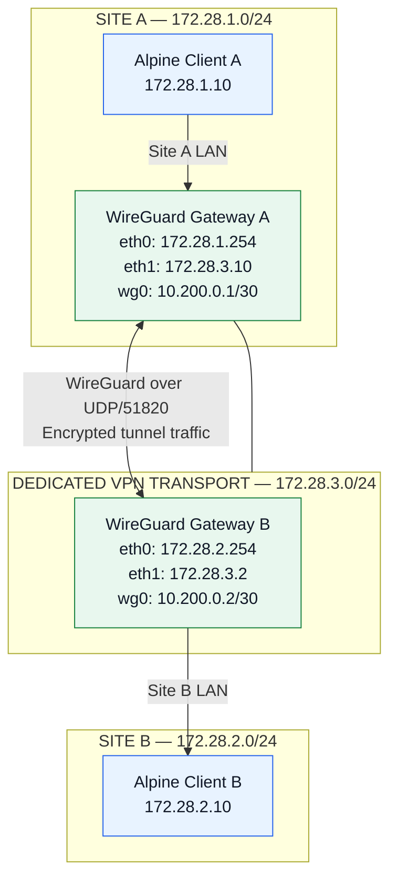

# containerized-zero-trust-vpn-lab
Docker Compose-based site-to-site WireGuard VPN lab with iptables firewall policies, network isolation, and encrypted traffic inspection using tcpdump.
# Containerized Zero-Trust VPN Gateway & Traffic Inspection Lab

A two-site, Docker Compose-based site-to-site VPN lab using WireGuard,
Alpine Linux test clients, and `iptables` firewall policies. The lab
demonstrates encrypted inter-site transport, least-privilege forwarding
rules, Telnet blocking, and packet inspection on both the encrypted
transport network and decrypted WireGuard interface.

> **Scope note:** This is a Zero-Trust-inspired networking lab. A
> WireGuard tunnel and firewall ACLs demonstrate authenticated encrypted
> connectivity and network-level access control, but do not by
> themselves constitute a complete Zero Trust architecture. A production
> design would also need identity-aware authorization, device posture
> checks, centralized policy, logging, monitoring, and key lifecycle
> management.

------------------------------------------------------------------------

## 1. Lab objectives

1.  Create two isolated Docker bridge networks representing Site A and
    Site B.
2.  Deploy one WireGuard gateway in each site.
3.  Connect the gateways through a dedicated Docker transport network.
4.  Configure WireGuard public-key peer authentication and site-to-site
    routing.
5.  Deploy Alpine test clients in both sites.
6.  Apply gateway `iptables` rules:
    -   Deny Telnet (TCP/23) between sites.
    -   Allow `ESTABLISHED,RELATED` traffic.
    -   Allow ICMP for connectivity testing.
    -   Allow TCP ports 80 and 443.
    -   Drop all other forwarded traffic by default.
7.  Verify client-to-client connectivity.
8.  Capture encrypted WireGuard UDP traffic on the transport bridge.
9.  Capture the original ICMP packets on the decrypted `wg0` interface.

## 2. Architecture



### Logical traffic flow

``` text
Alpine Client A
172.28.1.10
     |
     | Clear IP packet inside Site A
     v
Gateway A — wg0: 10.200.0.1
     |
     | WireGuard encapsulates and encrypts packet
     v
Transport network — UDP/51820
172.28.3.10 <==================> 172.28.3.2
                         encrypted
     |
     | Gateway B authenticates and decrypts packet
     v
Gateway B — wg0: 10.200.0.2
     |
     | Clear IP packet inside Site B
     v
Alpine Client B
172.28.2.10
```

The transport capture shows the outer UDP packets and gateway endpoint
addresses. The `wg0` capture shows the inner IP packet after decryption.
The outer UDP headers remain visible; the encapsulated traffic is
protected by WireGuard.

## 3. Addressing plan

  ------------------------------------------------------------------------
  Component        Interface                   IP address Purpose
  ---------------- ---------------- --------------------- ----------------
  Docker Site A    Host bridge            `172.28.1.1/24` Site A Docker
  bridge gateway                                          bridge

  Alpine Client A  `eth0`                `172.28.1.10/24` Site A test
                                                          client

  WireGuard        `eth0`               `172.28.1.254/24` Site A LAN
  Gateway A                                               interface

  Docker Site B    Host bridge            `172.28.2.1/24` Site B Docker
  bridge gateway                                          bridge

  Alpine Client B  `eth0`                `172.28.2.10/24` Site B test
                                                          client

  WireGuard        `eth0`               `172.28.2.254/24` Site B LAN
  Gateway B                                               interface

  Docker transport Host bridge            `172.28.3.1/24` VPN transport
  bridge gateway                                          network

  WireGuard        `eth1`                `172.28.3.10/24` Transport
  Gateway A                                               endpoint

  WireGuard        `eth1`                 `172.28.3.2/24` Transport
  Gateway B                                               endpoint

  WireGuard        `wg0`                  `10.200.0.1/30` VPN tunnel
  Gateway A                                               

  WireGuard        `wg0`                  `10.200.0.2/30` VPN tunnel
  Gateway B                                               
  ------------------------------------------------------------------------

**Docker bridge note:** Docker normally reserves `.1` in each bridge
subnet for the host-side bridge interface. Therefore, Gateway A uses
`172.28.3.10`, not `172.28.3.1`, on the transport network.

## 4. Prerequisites

-   Kali Linux or another Linux host with Docker Engine.
-   Docker Compose standalone command (`docker-compose`).
-   WireGuard kernel support and `/dev/net/tun`.
-   `tcpdump` on the host for transport capture.
-   Internet access to pull the container images.

Check the tools:

``` bash
docker --version
docker-compose --version
wg --version
ip -br -4 addr
which tcpdump
```

In this lab environment, the Compose command available was
`docker-compose` version `2.40.3-3`; `docker compose` was not available.
Commands below use `sudo docker` and `sudo docker-compose`.

Create the project directory:

``` bash
mkdir -p ~/zero-trust-vpn-lab
cd ~/zero-trust-vpn-lab
```

## 5. Create the Docker Compose deployment

Create `docker-compose.yml`:

``` yaml
services:
  vpn_gateway_a:
    image: lscr.io/linuxserver/wireguard:latest
    container_name: vpn-gateway-a
    cap_add:
      - NET_ADMIN
      - SYS_MODULE
    devices:
      - /dev/net/tun:/dev/net/tun
    sysctls:
      net.ipv4.conf.all.src_valid_mark: "1"
      net.ipv4.ip_forward: "1"
    environment:
      - PUID=1000
      - PGID=1000
      - TZ=Asia/Kolkata
    volumes:
      - ./wg_config_a:/config
      - /lib/modules:/lib/modules:ro
    networks:
      site_a_net:
        ipv4_address: 172.28.1.254
      vpn_transport:
        ipv4_address: 172.28.3.10
    restart: unless-stopped

  vpn_gateway_b:
    image: lscr.io/linuxserver/wireguard:latest
    container_name: vpn-gateway-b
    cap_add:
      - NET_ADMIN
      - SYS_MODULE
    devices:
      - /dev/net/tun:/dev/net/tun
    sysctls:
      net.ipv4.conf.all.src_valid_mark: "1"
      net.ipv4.ip_forward: "1"
    environment:
      - PUID=1000
      - PGID=1000
      - TZ=Asia/Kolkata
    volumes:
      - ./wg_config_b:/config
      - /lib/modules:/lib/modules:ro
    networks:
      site_b_net:
        ipv4_address: 172.28.2.254
      vpn_transport:
        ipv4_address: 172.28.3.2
    restart: unless-stopped

networks:
  site_a_net:
    driver: bridge
    ipam:
      config:
        - subnet: 172.28.1.0/24

  site_b_net:
    driver: bridge
    ipam:
      config:
        - subnet: 172.28.2.0/24

  vpn_transport:
    driver: bridge
    ipam:
      config:
        - subnet: 172.28.3.0/24
```

Validate the Compose file:

``` bash
sudo docker-compose config
```

Expected: Compose prints the normalized configuration without a YAML or
configuration error.

Create the configuration directories:

``` bash
mkdir -p wg_config_a/wg_confs wg_config_b/wg_confs keys
chmod 700 keys
umask 077
```

## 6. Generate WireGuard keys

Generate a separate key pair for each gateway:

``` bash
wg genkey | tee keys/gateway_a_private.key | wg pubkey > keys/gateway_a_public.key
wg genkey | tee keys/gateway_b_private.key | wg pubkey > keys/gateway_b_public.key

chmod 600 keys/gateway_a_private.key keys/gateway_b_private.key
chmod 644 keys/gateway_a_public.key keys/gateway_b_public.key
```

Display only public keys:

``` bash
cat keys/gateway_a_public.key
cat keys/gateway_b_public.key
```

**Security:** Never commit private keys to GitHub. The public keys can
be shared in peer configuration; private keys must remain secret. Add
the following to `.gitignore`:

``` gitignore
keys/
wg_config_a/
wg_config_b/
.env
```

The generated configuration files contain private keys, so they are
excluded from the repository by default. If you want to publish a
reproducible example, commit sanitized templates with placeholders, not
live secrets.

## 7. Configure WireGuard

Create Gateway A configuration:

``` bash
cat > wg_config_a/wg_confs/wg0.conf <<EOF
[Interface]
Address = 10.200.0.1/30
ListenPort = 51820
PrivateKey = $(cat keys/gateway_a_private.key)

[Peer]
PublicKey = $(cat keys/gateway_b_public.key)
Endpoint = 172.28.3.2:51820
AllowedIPs = 10.200.0.2/32, 172.28.2.0/24
PersistentKeepalive = 25
EOF
```

Create Gateway B configuration:

``` bash
cat > wg_config_b/wg_confs/wg0.conf <<EOF
[Interface]
Address = 10.200.0.2/30
ListenPort = 51820
PrivateKey = $(cat keys/gateway_b_private.key)

[Peer]
PublicKey = $(cat keys/gateway_a_public.key)
Endpoint = 172.28.3.10:51820
AllowedIPs = 10.200.0.1/32, 172.28.1.0/24
PersistentKeepalive = 25
EOF
```

Protect the configuration files:

``` bash
chmod 600 wg_config_a/wg_confs/wg0.conf
chmod 600 wg_config_b/wg_confs/wg0.conf
```

Review the configuration without printing private keys:

``` bash
grep -v 'PrivateKey' wg_config_a/wg_confs/wg0.conf
grep -v 'PrivateKey' wg_config_b/wg_confs/wg0.conf
```

### WireGuard peer configuration explanation

-   Gateway A's peer is Gateway B at `172.28.3.2:51820`.
-   Gateway B's peer is Gateway A at `172.28.3.10:51820`.
-   `AllowedIPs` identifies the remote tunnel address and remote site
    subnet.
-   `PersistentKeepalive = 25` sends periodic keepalive packets to
    maintain peer reachability through network devices.

## 8. Start the VPN gateways

Start both gateways:

``` bash
sudo docker-compose up -d
```

Check container status:

``` bash
sudo docker ps
```

Inspect startup logs:

``` bash
sudo docker logs vpn-gateway-a
sudo docker logs vpn-gateway-b
```

The relevant successful startup messages observed were:

``` text
**** Client mode selected. ****
**** Found WG conf /config/wg_confs/wg0.conf, adding to list ****
**** Activating tunnel /config/wg_confs/wg0.conf ****
[#] ip link add dev wg0 type wireguard
[#] wg addconf wg0 /dev/fd/63
[#] ip -4 address add ...
[#] ip link set mtu 1420 up dev wg0
[#] ip -4 route add ...
**** All tunnels are now active ****
```

Check interfaces:

``` bash
sudo docker exec vpn-gateway-a ip -br addr
sudo docker exec vpn-gateway-b ip -br addr
```

Expected key addresses:

``` text
Gateway A:
eth0  172.28.1.254/24
eth1  172.28.3.10/24
wg0   10.200.0.1/30

Gateway B:
eth0  172.28.2.254/24
eth1  172.28.3.2/24
wg0   10.200.0.2/30
```

Check IPv4 forwarding:

``` bash
sudo docker exec vpn-gateway-a sysctl net.ipv4.ip_forward
sudo docker exec vpn-gateway-b sysctl net.ipv4.ip_forward
```

Expected:

``` text
net.ipv4.ip_forward = 1
```

## 9. Verify the WireGuard handshake

Run:

``` bash
sudo docker exec vpn-gateway-a wg show
sudo docker exec vpn-gateway-b wg show
```

Representative Gateway A output from the completed lab (public keys are
included; private keys remain hidden):

``` text
interface: wg0
  public key: ME0qC9td4MuaMtxat4eBMpKEhrAG7q7Y/EQrCzEGTUs=
  private key: (hidden)
  listening port: 51820

peer: SfldIpMFqoNWZF4z08RzPMDhGXl9DThRX1+t2EzUQB4=
  endpoint: 172.28.3.2:51820
  allowed ips: 10.200.0.2/32, 172.28.2.0/24
  latest handshake: 23 seconds ago
  transfer: 4.31 KiB received, 5.06 KiB sent
  persistent keepalive: every 25 seconds
```

Handshake time and transfer counters change as the lab runs.

Test the tunnel addresses:

``` bash
sudo docker exec vpn-gateway-a ping -c 4 10.200.0.2
sudo docker exec vpn-gateway-b ping -c 4 10.200.0.1
```

Observed result for both tunnel-address tests:

``` text
4 packets transmitted, 4 packets received, 0% packet loss
```

## 10. Deploy Alpine test clients

Pull Alpine:

``` bash
sudo docker pull alpine:latest
```

Create the two clients with `NET_ADMIN`, which is required to add the
static routes:

``` bash
sudo docker run -dit --name alpine-client-a --cap-add NET_ADMIN \
  --network zero-trust-vpn-lab_site_a_net --ip 172.28.1.10 \
  alpine:latest sleep infinity

sudo docker run -dit --name alpine-client-b --cap-add NET_ADMIN \
  --network zero-trust-vpn-lab_site_b_net --ip 172.28.2.10 \
  alpine:latest sleep infinity
```

If the clients already exist and are running, do not recreate them
unnecessarily.

Verify client addresses:

``` bash
sudo docker exec alpine-client-a ip -br addr
sudo docker exec alpine-client-b ip -br addr
```

Expected:

``` text
alpine-client-a: 172.28.1.10/24
alpine-client-b: 172.28.2.10/24
```

## 11. Add routes on the Alpine clients

The clients need routes for the remote site subnet through their local
WireGuard gateway.

``` bash
sudo docker exec alpine-client-a ip route add 172.28.2.0/24 via 172.28.1.254
sudo docker exec alpine-client-b ip route add 172.28.1.0/24 via 172.28.2.254
```

Inspect routes:

``` bash
sudo docker exec alpine-client-a ip route
sudo docker exec alpine-client-b ip route
```

Observed output:

``` text
Client A:
default via 172.28.1.1 dev eth0
172.28.1.0/24 dev eth0 scope link src 172.28.1.10
172.28.2.0/24 via 172.28.1.254 dev eth0

Client B:
default via 172.28.2.1 dev eth0
172.28.1.0/24 via 172.28.2.254 dev eth0
172.28.2.0/24 dev eth0 scope link src 172.28.2.10
```

**Persistence note:** These routes were added manually inside the
running client containers. They are lost if the containers are
recreated. Re-run the route commands after recreating the clients, or
add a startup script/entrypoint for a persistent deployment.

## 12. Configure the firewall on Gateway A

The rules are deliberately ordered so Telnet is dropped before
established/related traffic is accepted.

``` bash
sudo docker exec vpn-gateway-a iptables -A FORWARD \
  -i eth0 -o wg0 -s 172.28.1.0/24 -d 172.28.2.0/24 \
  -p tcp --dport 23 -j DROP

sudo docker exec vpn-gateway-a iptables -A FORWARD \
  -i eth0 -o wg0 -s 172.28.1.0/24 -d 172.28.2.0/24 \
  -p tcp --sport 23 -j DROP

sudo docker exec vpn-gateway-a iptables -A FORWARD \
  -i wg0 -o eth0 -s 172.28.2.0/24 -d 172.28.1.0/24 \
  -p tcp --dport 23 -j DROP

sudo docker exec vpn-gateway-a iptables -A FORWARD \
  -i wg0 -o eth0 -s 172.28.2.0/24 -d 172.28.1.0/24 \
  -p tcp --sport 23 -j DROP

sudo docker exec vpn-gateway-a iptables -A FORWARD \
  -m conntrack --ctstate ESTABLISHED,RELATED -j ACCEPT

sudo docker exec vpn-gateway-a iptables -A FORWARD \
  -i eth0 -o wg0 -s 172.28.1.0/24 -d 172.28.2.0/24 \
  -p icmp -j ACCEPT

sudo docker exec vpn-gateway-a iptables -A FORWARD \
  -i wg0 -o eth0 -s 172.28.2.0/24 -d 172.28.1.0/24 \
  -p icmp -j ACCEPT

sudo docker exec vpn-gateway-a iptables -A FORWARD \
  -i eth0 -o wg0 -s 172.28.1.0/24 -d 172.28.2.0/24 \
  -p tcp -m multiport --dports 80,443 -j ACCEPT

sudo docker exec vpn-gateway-a iptables -A FORWARD \
  -i wg0 -o eth0 -s 172.28.2.0/24 -d 172.28.1.0/24 \
  -p tcp -m multiport --dports 80,443 -j ACCEPT

sudo docker exec vpn-gateway-a iptables -P FORWARD DROP
```

## 13. Configure the firewall on Gateway B

``` bash
sudo docker exec vpn-gateway-b iptables -A FORWARD \
  -i eth0 -o wg0 -s 172.28.2.0/24 -d 172.28.1.0/24 \
  -p tcp --dport 23 -j DROP

sudo docker exec vpn-gateway-b iptables -A FORWARD \
  -i eth0 -o wg0 -s 172.28.2.0/24 -d 172.28.1.0/24 \
  -p tcp --sport 23 -j DROP

sudo docker exec vpn-gateway-b iptables -A FORWARD \
  -i wg0 -o eth0 -s 172.28.1.0/24 -d 172.28.2.0/24 \
  -p tcp --dport 23 -j DROP

sudo docker exec vpn-gateway-b iptables -A FORWARD \
  -i wg0 -o eth0 -s 172.28.1.0/24 -d 172.28.2.0/24 \
  -p tcp --sport 23 -j DROP

sudo docker exec vpn-gateway-b iptables -A FORWARD \
  -m conntrack --ctstate ESTABLISHED,RELATED -j ACCEPT

sudo docker exec vpn-gateway-b iptables -A FORWARD \
  -i eth0 -o wg0 -s 172.28.2.0/24 -d 172.28.1.0/24 \
  -p icmp -j ACCEPT

sudo docker exec vpn-gateway-b iptables -A FORWARD \
  -i wg0 -o eth0 -s 172.28.1.0/24 -d 172.28.2.0/24 \
  -p icmp -j ACCEPT

sudo docker exec vpn-gateway-b iptables -A FORWARD \
  -i eth0 -o wg0 -s 172.28.2.0/24 -d 172.28.1.0/24 \
  -p tcp -m multiport --dports 80,443 -j ACCEPT

sudo docker exec vpn-gateway-b iptables -A FORWARD \
  -i wg0 -o eth0 -s 172.28.1.0/24 -d 172.28.2.0/24 \
  -p tcp -m multiport --dports 80,443 -j ACCEPT

sudo docker exec vpn-gateway-b iptables -P FORWARD DROP
```

### Inspect firewall rules

``` bash
sudo docker exec vpn-gateway-a iptables -L FORWARD -n -v --line-numbers
sudo docker exec vpn-gateway-b iptables -L FORWARD -n -v --line-numbers
```

Observed policy and rule structure on both gateways:

``` text
Chain FORWARD (policy DROP 0 packets, 0 bytes)
num  pkts bytes target  prot opt in    out  source          destination
1    0    0     DROP    tcp  --  eth0  wg0  172.28.1.0/24   172.28.2.0/24 tcp dpt:23
2    0    0     DROP    tcp  --  eth0  wg0  172.28.1.0/24   172.28.2.0/24 tcp spt:23
3    0    0     DROP    tcp  --  wg0   eth0 172.28.2.0/24   172.28.1.0/24 tcp dpt:23
4    0    0     DROP    tcp  --  wg0   eth0 172.28.2.0/24   172.28.1.0/24 tcp spt:23
5    0    0     ACCEPT  all  --  *     *    0.0.0.0/0       0.0.0.0/0 ctstate RELATED,ESTABLISHED
6    0    0     ACCEPT  icmp --  eth0  wg0  172.28.1.0/24   172.28.2.0/24
7    0    0     ACCEPT  icmp --  wg0   eth0 172.28.2.0/24   172.28.1.0/24
8    0    0     ACCEPT  tcp  --  eth0  wg0  172.28.1.0/24   172.28.2.0/24 multiport dports 80,443
9    0    0     ACCEPT  tcp  --  wg0   eth0 172.28.2.0/24   172.28.1.0/24 multiport dports 80,443
```

Gateway B has the source and destination subnets reversed for its
local/remote site directions.

## 14. Test site-to-site connectivity

Ping from Client A to Client B:

``` bash
sudo docker exec alpine-client-a ping -c 4 172.28.2.10
```

Observed:

``` text
PING 172.28.2.10 (172.28.2.10): 56 data bytes
64 bytes from 172.28.2.10: seq=0 ttl=62 time=1.636 ms
64 bytes from 172.28.2.10: seq=1 ttl=62 time=2.955 ms
64 bytes from 172.28.2.10: seq=2 ttl=62 time=1.631 ms
64 bytes from 172.28.2.10: seq=3 ttl=62 time=1.491 ms

4 packets transmitted, 4 packets received, 0% packet loss
round-trip min/avg/max = 1.491/1.928/2.955 ms
```

Ping from Client B to Client A:

``` bash
sudo docker exec alpine-client-b ping -c 4 172.28.1.10
```

Observed:

``` text
PING 172.28.1.10 (172.28.1.10): 56 data bytes
64 bytes from 172.28.1.10: seq=0 ttl=62 time=1.637 ms
64 bytes from 172.28.1.10: seq=1 ttl=62 time=3.243 ms
64 bytes from 172.28.1.10: seq=2 ttl=62 time=1.514 ms
64 bytes from 172.28.1.10: seq=3 ttl=62 time=6.351 ms

4 packets transmitted, 4 packets received, 0% packet loss
round-trip min/avg/max = 1.514/3.186/6.351 ms
```

A later five-packet test also succeeded:

``` text
5 packets transmitted, 5 packets received, 0% packet loss
round-trip min/avg/max = 1.779/3.174/6.456 ms
```

## 15. Test Telnet blocking

Check that Netcat exists:

``` bash
sudo docker exec alpine-client-a which nc
sudo docker exec alpine-client-b which nc
```

Observed:

``` text
/usr/bin/nc
/usr/bin/nc
```

Start a temporary listener on TCP port 23 in Client B:

``` bash
sudo docker exec -d alpine-client-b sh -c 'nc -l -p 23'
```

Attempt a connection from Client A:

``` bash
sudo docker exec alpine-client-a nc -z -w 3 172.28.2.10 23
```

The command returned no success message. The firewall counter confirmed
that the packets were dropped.

Inspect counters:

``` bash
sudo docker exec vpn-gateway-a iptables -L FORWARD -n -v --line-numbers
sudo docker exec vpn-gateway-b iptables -L FORWARD -n -v --line-numbers
```

Observed relevant Gateway A counters after the Telnet test:

``` text
1   3   180 DROP  tcp  --  eth0  wg0  172.28.1.0/24  172.28.2.0/24  tcp dpt:23
```

This means three TCP packets (180 bytes total) matched the Telnet drop
rule. Gateway B's Telnet counters remained zero because Gateway A
dropped the connection before it reached Site B.

## 16. Capture encrypted WireGuard transport traffic

Identify the host-side Docker bridge for the transport network:

``` bash
ip -br -4 addr | grep '172.28.3.1'
```

Observed:

``` text
br-ae57ae1b692c  UP  172.28.3.1/24
```

Capture UDP port 51820:

``` bash
sudo tcpdump -ni br-ae57ae1b692c 'udp port 51820'
```

While tcpdump is running, generate traffic:

``` bash
sudo docker exec alpine-client-a ping -c 5 172.28.2.10
```

Representative observed capture:

``` text
19:09:43.876652 IP 172.28.3.10.51820 > 172.28.3.2.51820: UDP, length 128
19:09:43.877355 IP 172.28.3.2.51820 > 172.28.3.10.51820: UDP, length 128
19:09:44.878762 IP 172.28.3.10.51820 > 172.28.3.2.51820: UDP, length 128
19:09:44.879268 IP 172.28.3.2.51820 > 172.28.3.10.51820: UDP, length 128
19:09:45.880236 IP 172.28.3.10.51820 > 172.28.3.2.51820: UDP, length 128
19:09:45.884067 IP 172.28.3.2.51820 > 172.28.3.10:51820: UDP, length 128
```

Additional packets were captured in both directions. The observed
endpoints were:

-   Gateway A transport address: `172.28.3.10:51820`
-   Gateway B transport address: `172.28.3.2:51820`

This is the outer WireGuard UDP transport. The capture does not display
the original ICMP payload as readable ICMP packets on this transport
interface.

Stop the capture with `Ctrl+C`.

## 17. Capture decrypted traffic on `wg0`

The LinuxServer WireGuard image did not include `tcpdump`:

``` bash
sudo docker exec vpn-gateway-a tcpdump -ni wg0 icmp
```

Observed error:

``` text
exec: "tcpdump": executable file not found in $PATH
```

Use a temporary diagnostic container sharing Gateway A's network
namespace instead:

``` bash
sudo docker run --rm -it \
  --network container:vpn-gateway-a \
  --cap-add NET_RAW \
  --cap-add NET_ADMIN \
  nicolaka/netshoot \
  tcpdump -ni wg0 icmp
```

In a second terminal, generate traffic:

``` bash
sudo docker exec alpine-client-a ping -c 5 172.28.2.10
```

Observed decrypted tunnel capture:

``` text
listening on wg0, link-type RAW (Raw IP), snapshot length 262144 bytes
13:44:27.752633 IP 172.28.1.10 > 172.28.2.10: ICMP echo request, id 46, seq 0, length 64
13:44:27.753845 IP 172.28.2.10 > 172.28.1.10: ICMP echo reply, id 46, seq 0, length 64
13:44:28.755838 IP 172.28.1.10 > 172.28.2.10: ICMP echo request, id 46, seq 1, length 64
13:44:28.759808 IP 172.28.2.10 > 172.28.1.10: ICMP echo reply, id 46, seq 1, length 64
13:44:29.756535 IP 172.28.1.10 > 172.28.2.10: ICMP echo request, id 46, seq 2, length 64
13:44:29.758251 IP 172.28.2.10 > 172.28.1.10: ICMP echo reply, id 46, seq 2, length 64
13:44:30.784188 IP 172.28.1.10 > 172.28.2.10: ICMP echo request, id 46, seq 3, length 64
13:44:30.790224 IP 172.28.2.10 > 172.28.1.10: ICMP echo reply, id 46, seq 3, length 64
13:44:31.950397 IP 172.28.1.10 > 172.28.2.10: ICMP echo request, id 46, seq 4, length 64
13:44:31.959715 IP 172.28.2.10 > 172.28.1.10: ICMP echo reply, id 46, seq 4, length 64
```

This proves that the original inner IP traffic is visible on the
WireGuard interface after decryption. The transport capture and
tunnel-interface capture together demonstrate encapsulation and
encryption.

Stop the diagnostic capture with `Ctrl+C`. Because the container was
started with `--rm`, it is removed automatically when stopped.

## 18. Final verification summary

  -----------------------------------------------------------------------
  Requirement             Verification            Result
  ----------------------- ----------------------- -----------------------
  Docker Compose gateways Both gateway containers PASS
                          running                 

  Separate site networks  Site A and Site B       PASS
                          bridge networks         

  WireGuard tunnel        Peer handshake and      PASS
                          transfer counters       

  Tunnel reachability     Gateway tunnel IP pings PASS

  Alpine clients          Client A and Client B   PASS
                          deployed                

  Static routing          Client routes point to  PASS
                          local gateways          

  Site-to-site            Bidirectional client    PASS
  connectivity            ping                    

  Telnet policy           TCP/23 attempt dropped  PASS

  Stateful firewall       `ESTABLISHED,RELATED`   PASS
                          accept rule present     

  Least-privilege         ICMP and TCP 80/443     PASS
  forwarding              explicitly permitted    

  Default-deny forwarding `FORWARD` policy is     PASS
                          `DROP`                  

  Encrypted transport     UDP/51820 captured on   PASS
  inspection              transport bridge        

  Decrypted tunnel        ICMP captured on `wg0`  PASS
  inspection                                      
  -----------------------------------------------------------------------

## 19. Useful troubleshooting commands

Container status:

``` bash
sudo docker ps -a
sudo docker-compose ps
```

Gateway logs:

``` bash
sudo docker logs --tail 100 vpn-gateway-a
sudo docker logs --tail 100 vpn-gateway-b
```

WireGuard status:

``` bash
sudo docker exec vpn-gateway-a wg show
sudo docker exec vpn-gateway-b wg show
```

Routes:

``` bash
sudo docker exec vpn-gateway-a ip route
sudo docker exec vpn-gateway-b ip route
sudo docker exec alpine-client-a ip route
sudo docker exec alpine-client-b ip route
```

Firewall rules and counters:

``` bash
sudo docker exec vpn-gateway-a iptables -L FORWARD -n -v --line-numbers
sudo docker exec vpn-gateway-b iptables -L FORWARD -n -v --line-numbers
```

Transport capture:

``` bash
sudo tcpdump -ni br-ae57ae1b692c 'udp port 51820'
```

Decrypted tunnel capture:

``` bash
sudo docker run --rm -it \
  --network container:vpn-gateway-a \
  --cap-add NET_RAW \
  --cap-add NET_ADMIN \
  nicolaka/netshoot \
  tcpdump -ni wg0 icmp
```

## 20. Cleanup

> Run these commands only when you are finished with the lab. They
> remove the lab containers and Compose-created networks.

Stop and remove the Compose gateways and networks:

``` bash
sudo docker-compose down
```

Remove the Alpine test clients:

``` bash
sudo docker rm -f alpine-client-a alpine-client-b
```

Optionally remove the downloaded diagnostic and Alpine images:

``` bash
sudo docker image rm nicolaka/netshoot:latest alpine:latest
```

Remove local key/config files only if you no longer need them:

``` bash
rm -rf keys wg_config_a wg_config_b
```

Do not remove unrelated Docker networks or containers from other
projects.

## 21. GitHub repository checklist

Suggested repository layout:

``` text
zero-trust-vpn-lab/
├── README.md
├── docker-compose.yml
├── .gitignore
└── docs/
    └── screenshots/
        ├── wireguard-handshake.png
        ├── firewall-rules.png
        ├── telnet-blocked.png
        ├── encrypted-udp-capture.png
        └── decrypted-wg0-capture.png
```

Before pushing, make sure private keys and live WireGuard configs are
excluded:

``` bash
git status --short
git check-ignore keys/gateway_a_private.key
git check-ignore wg_config_a/wg_confs/wg0.conf
```

Initialize and push (replace the remote URL with your own GitHub
repository URL):

``` bash
git init
git add README.md docker-compose.yml .gitignore docs/
git commit -m "Add containerized WireGuard zero-trust VPN lab"
git branch -M main
git remote add origin <YOUR_GITHUB_REPOSITORY_URL>
git push -u origin main
```

Never commit private keys, passwords, or unredacted secret configuration
files.

------------------------------------------------------------------------

## Conclusion

The lab successfully connected two isolated Docker site networks through
a WireGuard site-to-site VPN. Both Alpine clients communicated in both
directions with zero packet loss. The gateway firewalls blocked Telnet,
allowed the explicitly permitted traffic, and used a default-deny
forwarding policy. Packet captures showed encrypted WireGuard UDP
traffic on the transport bridge and the original ICMP packets on the
decrypted `wg0` interface.

**Final result: all stated practical verification tests completed
successfully.**
